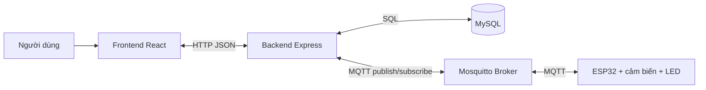
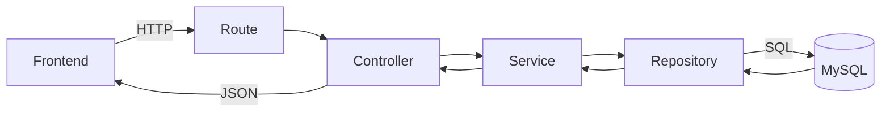
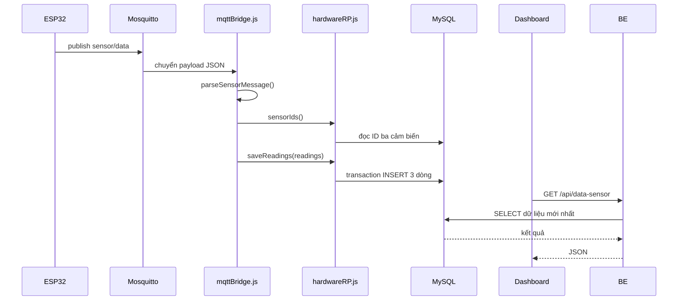
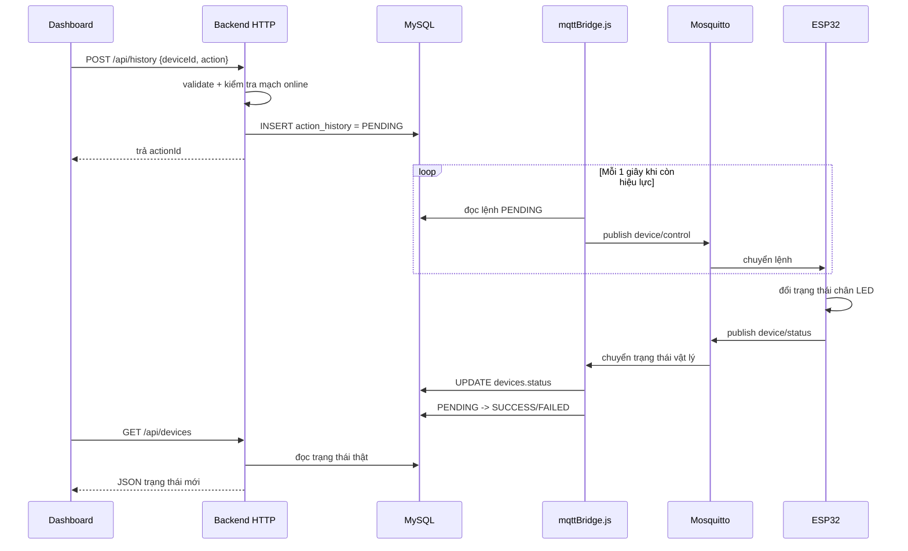
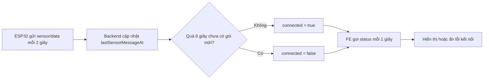
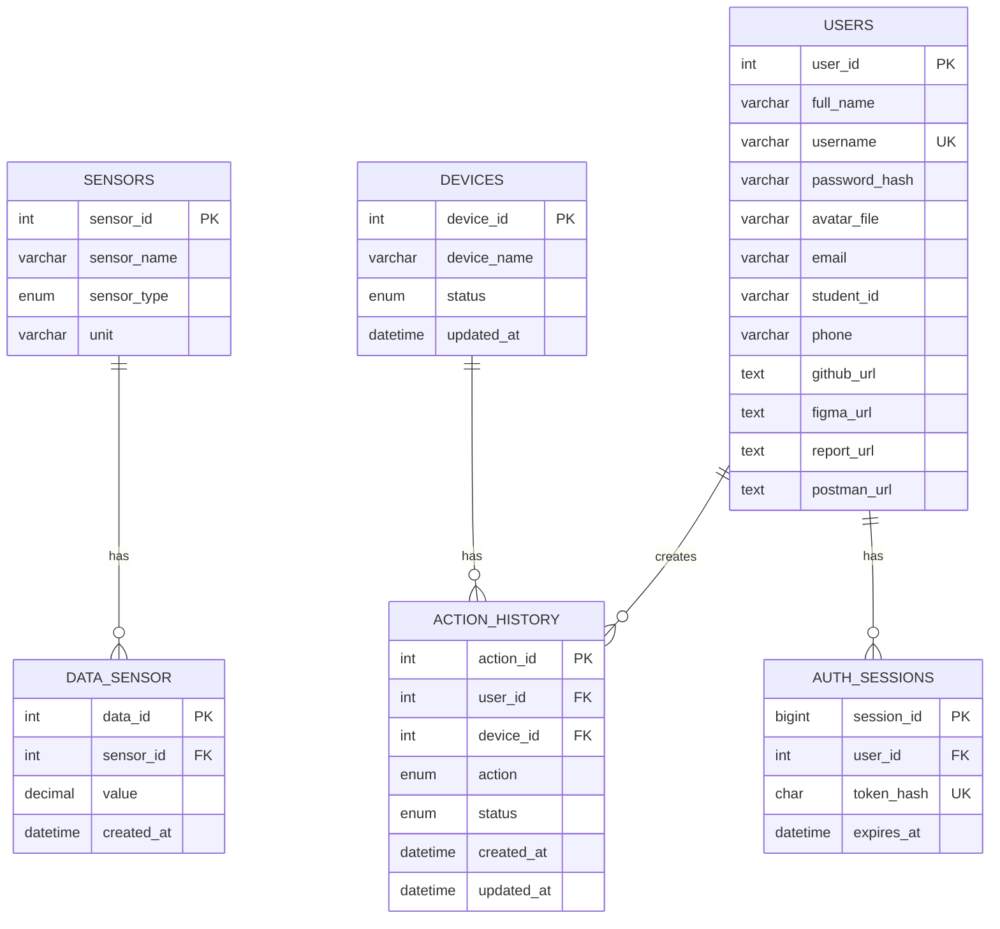

# Hướng dẫn học Backend và kiến trúc hệ thống IoT

Tài liệu này giải thích đúng theo mã nguồn hiện tại của dự án `He_thong_IoT`. Mục tiêu là giúp bạn hiểu:

- Backend được chia thành những lớp nào.
- FE, BE, MySQL, Mosquitto và ESP32 liên lạc với nhau ra sao.
- Dữ liệu cảm biến và lệnh điều khiển đi qua hệ thống như thế nào.
- Nên đọc và học từng file theo thứ tự nào.
- Những kiến thức nào là cốt lõi, cần hiểu thay vì chỉ học thuộc code.

---

## 1. Bức tranh tổng thể

Hệ thống có năm thành phần chính:



Vai trò của từng thành phần:

| Thành phần | Vai trò chính |
| --- | --- |
| Frontend React | Hiển thị dữ liệu, nhận thao tác người dùng, gọi REST API. |
| Backend Express | Kiểm tra request, xử lý nghiệp vụ, đọc/ghi MySQL và làm cầu nối MQTT. |
| MySQL | Lưu dữ liệu cảm biến, trạng thái LED và lịch sử lệnh. |
| Mosquitto | Chuyển tiếp bản tin MQTT giữa backend và ESP32. Mosquitto không xử lý nghiệp vụ. |
| ESP32 | Đọc cảm biến, điều khiển chân LED và báo trạng thái vật lý về hệ thống. |

Điểm cần nhớ:

> Frontend không nói chuyện trực tiếp với ESP32. Frontend gọi Backend bằng HTTP; Backend liên lạc với ESP32 thông qua Mosquitto bằng MQTT.

---

## 2. Hai giao thức đang được dùng

### 2.1. HTTP giữa Frontend và Backend

HTTP phù hợp cho thao tác dạng yêu cầu–phản hồi:

```text
Frontend gửi request -> Backend xử lý -> Backend trả JSON
```

Ví dụ:

```http
GET /api/devices
```

Backend trả:

```json
[
  {
    "deviceId": 1,
    "deviceName": "LED 1",
    "status": "ON",
    "pendingActionId": null
  }
]
```

### 2.2. MQTT giữa Backend và ESP32

MQTT hoạt động theo mô hình publish/subscribe:

```text
Publisher -> Topic trên Mosquitto -> Subscriber
```

Publisher không cần biết subscriber là ai. Nó chỉ cần biết tên topic.

Các topic của dự án:

| Topic | Bên gửi | Bên nhận | Mục đích |
| --- | --- | --- | --- |
| `sensor/data` | ESP32 | Backend | Gửi nhiệt độ, độ ẩm và ánh sáng. |
| `device/control` | Backend | ESP32 | Gửi lệnh bật/tắt LED. |
| `device/status` | ESP32 | Backend | Báo trạng thái chân LED sau khi thay đổi. |

Payload mẫu:

```json
// sensor/data
{
  "temperature": 27.4,
  "humidity": 68,
  "light": 35.2
}
```

```json
// device/control
{
  "actionId": 123,
  "deviceId": 3,
  "command": "ON"
}
```

```json
// device/status: phản hồi một lệnh từ Dashboard
{
  "actionId": 123,
  "deviceId": 3,
  "status": "ON"
}
```

```json
// device/status: trạng thái tự phát khi điều khiển từ nơi khác
{
  "deviceId": 3,
  "status": "ON"
}
```

---

## 3. Cấu trúc thư mục Backend

```text
BE/
├── .env                       Cấu hình thật trên máy, không đưa lên Git
├── .env.example               Mẫu các biến môi trường cần có
├── package.json               Thư viện và lệnh chạy backend
├── README.md                  Ghi chú vận hành backend
├── src/
│   ├── app.js                 Điểm khởi động Express và MQTT bridge
│   ├── db.js                  Tạo connection pool tới MySQL
│   ├── routes/                Khai báo URL và HTTP method
│   │   ├── dataSensorRT.js
│   │   ├── deviceRT.js
│   │   ├── historyRT.js
│   │   └── hardwareRT.js
│   ├── controller/            Đọc request, kiểm tra đầu vào, trả response
│   │   ├── dataSensorCtrl.js
│   │   ├── deviceCtrl.js
│   │   └── historyCtrl.js
│   ├── service/               Nghiệp vụ và kết nối MQTT
│   │   ├── dataSensorSV.js
│   │   ├── deviceSV.js
│   │   ├── historySV.js
│   │   ├── pagination.js
│   │   └── mqttBridge.js
│   └── repos/                 Truy vấn và giao dịch MySQL
│       ├── dataSensorRP.js
│       ├── deviceRP.js
│       ├── historyRP.js
│       ├── hardwareRP.js
│       └── rowFormat.js
└── test/
    ├── db-api.test.js         Test API và MySQL
    └── mqtt-bridge.test.js    Test định dạng MQTT và trạng thái mạch
```

Quy ước tên hiện tại:

- `RT`: Route.
- `Ctrl`: Controller.
- `SV`: Service.
- `RP`: Repository.

---

## 4. Kiến trúc các lớp của Backend

Một request HTTP thông thường đi theo thứ tự:



### 4.1. Route

Route trả lời câu hỏi:

> URL nào và HTTP method nào sẽ gọi hàm controller nào?

Ví dụ trong `historyRT.js`:

```js
router.get("/", ctrl.listHistory);
router.post("/", ctrl.recordHistory);
```

Khi router này được gắn tại `/api/history`, ta có:

- `GET /api/history` để đọc lịch sử.
- `POST /api/history` để tạo lệnh điều khiển.

Route nên ngắn, không viết SQL hoặc nghiệp vụ dài tại đây.

### 4.2. Controller

Controller chịu trách nhiệm:

- Đọc `req.params`, `req.query`, `req.body`.
- Kiểm tra dữ liệu đầu vào.
- Gọi service.
- Chọn HTTP status phù hợp.
- Trả JSON qua `res.json()`.

Ví dụ `historyCtrl.js` kiểm tra:

- `deviceId` phải là số nguyên dương.
- `action` chỉ được là `ON` hoặc `OFF`.
- LED phải nằm trong `MQTT_DEVICE_IDS`.
- Mạch phải đang gửi dữ liệu.

### 4.3. Service

Service chứa nghiệp vụ hoặc phối hợp nhiều thao tác.

Ví dụ `dataSensorSV.js`:

1. Chuẩn hóa `page` và `limit`.
2. Tính `offset`.
3. Gọi repository lấy dữ liệu.
4. Gọi repository đếm tổng số dòng.
5. Tính `totalPages`.

Không phải service nào cũng dài. `deviceSV.js` hiện chỉ chuyển tiếp sang repository vì nghiệp vụ thiết bị còn đơn giản.

### 4.4. Repository

Repository là lớp làm việc trực tiếp với MySQL:

- Viết câu SQL.
- Truyền tham số an toàn.
- Dùng transaction khi nhiều câu SQL phải thành công cùng nhau.
- Chuyển dữ liệu DB sang cấu trúc phù hợp cho API.

Ví dụ:

```js
const [rows] = await db.execute(
  "SELECT ... WHERE device_id = ?",
  [deviceId],
);
```

Dấu `?` giúp tách dữ liệu khỏi câu SQL và giảm nguy cơ SQL injection.

### 4.5. Database connection pool

`db.js` tạo một pool kết nối MySQL dùng chung:

```text
Controller/Service không tự mở kết nối MySQL.
Repository lấy kết nối từ pool khi cần.
```

Pool giúp tái sử dụng kết nối, giới hạn số kết nối đồng thời và tránh chi phí mở kết nối mới cho mỗi request.

### 4.6. Ngoại lệ trong cấu trúc hiện tại

`hardwareRT.js` đang gọi trực tiếp `hardwareRP.js` và `mqttBridge.js`, không đi qua controller/service riêng. Cách này vẫn chạy đúng vì endpoint nhỏ, nhưng nếu dự án lớn hơn nên tách thành:

```text
hardwareRT -> hardwareCtrl -> hardwareSV -> hardwareRP
```

Đây là điểm tốt để bạn thực hành refactor sau khi đã hiểu toàn bộ luồng.

---

## 5. Vai trò từng file Backend

### Nhóm khởi động và cấu hình

| File | Cần hiểu |
| --- | --- |
| `BE/package.json` | Thư viện Express, MQTT, MySQL, dotenv; lệnh `npm start`, `npm test`. |
| `BE/.env.example` | Tên các biến môi trường, không chứa mật khẩu thật. |
| `BE/src/app.js` | Tạo Express app, gắn middleware, gắn route, mở MQTT bridge và cổng HTTP. |
| `BE/src/db.js` | Đọc biến môi trường và tạo MySQL connection pool. |

### Nhóm dữ liệu cảm biến

| File | Cần hiểu |
| --- | --- |
| `routes/dataSensorRT.js` | Khai báo `GET /api/data-sensor`. |
| `controller/dataSensorCtrl.js` | Đọc từ khóa, loại cảm biến, trường tìm kiếm và phân trang. |
| `service/dataSensorSV.js` | Tính offset và đóng gói kết quả phân trang. |
| `repos/dataSensorRP.js` | JOIN `data_sensor` với `sensors`, lọc, tìm kiếm và đếm dữ liệu. |

### Nhóm thiết bị

| File | Cần hiểu |
| --- | --- |
| `routes/deviceRT.js` | Khai báo `GET /api/devices`. |
| `controller/deviceCtrl.js` | Trả danh sách thiết bị hoặc lỗi 500. |
| `service/deviceSV.js` | Chuyển yêu cầu xuống repository. |
| `repos/deviceRP.js` | Đọc trạng thái LED và lệnh đang chờ. |

### Nhóm lịch sử và tạo lệnh điều khiển

| File | Cần hiểu |
| --- | --- |
| `routes/historyRT.js` | Khai báo GET lịch sử và POST tạo lệnh. |
| `controller/historyCtrl.js` | Validate lệnh, kiểm tra mạch, ánh xạ lỗi thành HTTP status. |
| `service/historySV.js` | Phân trang lịch sử và gọi thao tác ghi lệnh. |
| `repos/historyRP.js` | Lọc lịch sử và tạo bản ghi `PENDING` bằng transaction. |

### Nhóm MQTT và trạng thái phần cứng

| File | Cần hiểu |
| --- | --- |
| `service/mqttBridge.js` | Kết nối Mosquitto, subscribe dữ liệu/trạng thái và publish lệnh. |
| `repos/hardwareRP.js` | Lưu cảm biến, đọc lệnh chờ, cập nhật trạng thái LED và lịch sử. |
| `routes/hardwareRT.js` | Trả trạng thái mạch qua `GET /api/hardware/status`. |

### Nhóm dùng chung và kiểm thử

| File | Cần hiểu |
| --- | --- |
| `service/pagination.js` | Chuẩn hóa và giới hạn `page`, `limit`. |
| `repos/rowFormat.js` | Chuyển thời gian MySQL theo giờ Việt Nam sang ISO và chuỗi hiển thị. |
| `test/db-api.test.js` | Kiểm tra API, kiểu dữ liệu, bộ lọc và MySQL. |
| `test/mqtt-bridge.test.js` | Kiểm tra payload MQTT và logic online/offline. |

---

## 6. Các API và nơi Frontend sử dụng

| API Backend | Method | FE service gọi | Trang sử dụng |
| --- | --- | --- | --- |
| `/api/data-sensor` | GET | `FE/src/services/dataSensorSV.js` | Dashboard, DataSensor |
| `/api/devices` | GET | `FE/src/services/deviceSV.js` | Dashboard, History |
| `/api/history` | GET | `FE/src/services/historySV.js` | History |
| `/api/history` | POST | `FE/src/services/historySV.js` | Công tắc LED trên Dashboard |
| `/api/hardware/status` | GET | `FE/src/services/hardwareSV.js` | Dashboard |

Trong môi trường phát triển, FE gọi đường dẫn tương đối `/api`. `FE/vite.config.js` chuyển tiếp request đó tới:

```text
http://localhost:3001
```

Ví dụ:

```text
Trình duyệt gọi: http://localhost:5173/api/devices
Vite proxy tới: http://localhost:3001/api/devices
```

`FE/src/services/apiConfig.js` là nơi tạo URL gốc dùng chung cho các FE service.

Phân biệt hai loại service:

- `FE/src/services/*`: hàm `fetch()` để gọi HTTP API.
- `BE/src/service/*`: lớp nghiệp vụ chạy trên server.

Hai thư mục cùng tên nhưng nhiệm vụ hoàn toàn khác nhau.

---

## 7. Luồng dữ liệu cảm biến



Logic từng bước:

1. ESP32 đọc ba cảm biến.
2. ESP32 publish một JSON lên `sensor/data`.
3. Mosquitto chuyển bản tin cho backend đã subscribe topic này.
4. `mqttBridge.js` kiểm tra JSON và đổi ba giá trị thành ba reading.
5. `hardwareRP.js` dùng transaction để lưu cả ba reading vào MySQL.
6. `lastSensorMessageAt` được cập nhật sau khi lưu thành công.
7. Frontend không dùng trực tiếp bản tin MQTT; frontend gọi API để đọc dữ liệu đã lưu.
8. Dashboard cập nhật các thẻ và biểu đồ.

Vì sao cần transaction khi lưu ba cảm biến?

> Nếu lưu nhiệt độ thành công nhưng lưu độ ẩm thất bại, transaction rollback toàn bộ. Database không bị rơi vào trạng thái một gói MQTT chỉ lưu được một phần.

---

## 8. Luồng bật/tắt LED từ Dashboard



Điểm quan trọng nhất:

> Nhấn nút trên giao diện không được coi là LED đã bật. Nó chỉ tạo một lệnh `PENDING`. Chỉ khi ESP32 báo trạng thái chân về, backend mới cập nhật trạng thái thật và kết thúc lệnh.

Ba trạng thái của một lệnh:

| Trạng thái | Ý nghĩa |
| --- | --- |
| `PENDING` | Backend đã nhận yêu cầu nhưng ESP32 chưa xác nhận. |
| `SUCCESS` | Trạng thái chân ESP32 báo về trùng với lệnh yêu cầu. |
| `FAILED` | ESP32 báo trạng thái không khớp hoặc lệnh hết hạn. |

`actionId` giúp backend ghép đúng phản hồi với đúng lệnh, tránh nhầm phản hồi cũ với lệnh mới.

---

## 9. Điều khiển LED từ terminal hoặc nguồn khác

Nếu LED được điều khiển ngoài Dashboard, frontend chỉ phản ánh đúng khi ESP32 vẫn báo trạng thái vật lý:

```text
Terminal -> device/control -> Mosquitto -> ESP32
ESP32 đổi chân LED
ESP32 -> device/status -> Mosquitto -> Backend
Backend cập nhật devices.status
Dashboard gọi GET /api/devices và hiển thị trạng thái mới
```

Trong trường hợp này, `device/status` có thể không có `actionId`:

```json
{
  "deviceId": 2,
  "status": "ON"
}
```

Backend vẫn cập nhật `devices.status`, nhưng không đánh dấu một lệnh Dashboard là thành công nếu không có `actionId` phù hợp. Với lệnh terminal điều khiển một LED, backend ghi một dòng `SUCCESS` khi trạng thái thực thay đổi; báo lại cùng trạng thái không ghi trùng. Với lệnh điều khiển cả ba LED (`deviceId: 0`), phản hồi nhóm từ firmware cũ tạo ba dòng `SUCCESS` riêng cho `device_id` 1, 2 và 3. Firmware mới phát ba phản hồi mang `groupCommand: true` để ghi lịch sử theo trạng thái từng chân. Các gói trạng thái định kỳ không tạo dòng lịch sử khi trạng thái không đổi.

Nếu ESP32 chỉ đổi chân mà không publish `device/status`, Backend và Frontend không có cách biết trạng thái vật lý đã thay đổi.

---

## 10. Luồng phát hiện rút mạch

Backend không kết nối trực tiếp với ESP32. Backend kết nối tới Mosquitto, nên khi rút ESP32 thì kết nối Backend–Mosquitto vẫn còn.

Hệ thống dùng heartbeat dựa trên dữ liệu cảm biến:



Độ trễ dự kiến khi rút mạch là khoảng 6–7 giây:

- Tối đa 6 giây để backend xác định mất ba nhịp dữ liệu.
- Tối đa khoảng 1 giây để lần polling tiếp theo của frontend nhận trạng thái.

Không nên báo offline ngay khi thiếu một gói 2 giây vì mạng có thể trễ hoặc mất một bản tin tạm thời.

Nếu muốn phát hiện nhanh hơn trong hệ thống production, nên dùng MQTT Last Will and Testament và đẩy sự kiện tới FE bằng WebSocket hoặc Server-Sent Events.

---

## 11. Database và nguồn dữ liệu đúng

### 11.1. Quan hệ giữa các bảng



### 11.2. Nguồn sự thật của từng loại trạng thái

| Thông tin | Nguồn sự thật |
| --- | --- |
| Số đo cảm biến | Các dòng trong `data_sensor`. |
| Tên và loại cảm biến | Bảng `sensors`. |
| Trạng thái vật lý gần nhất của LED | `devices.status`, được cập nhật từ `device/status`. |
| Trạng thái xử lý một lệnh | `action_history.status`. |
| Mạch đang online hay không | MQTT stream gần nhất kết hợp thời điểm dữ liệu cảm biến. |
| Trạng thái React trên trình duyệt | Chỉ là bản sao để hiển thị, không phải nguồn sự thật lâu dài. |

Đây là nguyên tắc rất quan trọng khi debug: trước tiên phải xác định dữ liệu nào đang là nguồn sự thật.

---

## 12. Ý nghĩa các biến môi trường

| Biến | Ý nghĩa |
| --- | --- |
| `PORT` | Cổng HTTP của backend, mặc định dự án dùng `3001`. |
| `DB_HOST`, `DB_PORT` | Địa chỉ MySQL. |
| `DB_USER`, `DB_PASSWORD`, `DB_NAME` | Thông tin đăng nhập và database cần dùng. |
| `MQTT_URL` | Địa chỉ Mosquitto, dạng `mqtt://host:port`. |
| `MQTT_USER`, `MQTT_PASSWORD` | Tài khoản MQTT. |
| `MQTT_DEVICE_IDS` | Danh sách ID LED mà firmware thực sự hỗ trợ. |
| `HARDWARE_STALE_MS` | Thời gian không có cảm biến trước khi coi mạch offline. |
| `HARDWARE_COMMAND_TIMEOUT_MS` | Thời gian tối đa chờ xác nhận một lệnh LED. |

Không đưa `BE/.env` thật lên Git vì file này chứa thông tin đăng nhập. Chỉ commit `.env.example`.

---

## 13. Thứ tự học từng file

Không nên đọc toàn bộ repository theo thứ tự bảng chữ cái. Hãy học theo một luồng hoàn chỉnh.

### Giai đoạn 1: Khởi động hệ thống

1. `BE/package.json`
2. `BE/.env.example`
3. `BE/src/app.js`
4. `BE/src/db.js`
5. `FE/vite.config.js`
6. `FE/src/services/apiConfig.js`

Sau giai đoạn này, bạn cần trả lời được:

- Lệnh nào chạy backend?
- Express mở cổng nào?
- Route được gắn ở đâu?
- MySQL và Mosquitto lấy cấu hình từ đâu?
- Vì sao FE gọi `/api` nhưng request vẫn tới cổng 3001?

### Giai đoạn 2: Học một request GET đơn giản

Đọc luồng thiết bị vì đây là luồng ngắn nhất:

1. `BE/src/routes/deviceRT.js`
2. `BE/src/controller/deviceCtrl.js`
3. `BE/src/service/deviceSV.js`
4. `BE/src/repos/deviceRP.js`
5. `FE/src/services/deviceSV.js`
6. Phần lấy thiết bị trong `FE/src/pages/Dashboard/Dashboard.jsx`

Theo dõi một request từ `fetch()` tới SQL rồi quay lại JSX.

### Giai đoạn 3: Học tìm kiếm và phân trang

1. `BE/src/routes/dataSensorRT.js`
2. `BE/src/controller/dataSensorCtrl.js`
3. `BE/src/service/pagination.js`
4. `BE/src/service/dataSensorSV.js`
5. `BE/src/repos/dataSensorRP.js`
6. `FE/src/services/dataSensorSV.js`
7. `FE/src/pages/DataSensor/DataSensor.jsx`

Các nội dung cần nắm:

- Query string.
- `LIMIT`, `OFFSET`.
- Tổng số dòng và tổng số trang.
- Bộ lọc SQL động nhưng vẫn dùng tham số `?`.
- Cache `localStorage` phía frontend.
- Hủy request bằng `AbortController`.

### Giai đoạn 4: Học MQTT nhận dữ liệu cảm biến

1. `BE/src/service/mqttBridge.js`: phần kết nối, subscribe và `sensor/data`.
2. `parseSensorMessage()`.
3. `BE/src/repos/hardwareRP.js`: `sensorIds()` và `saveReadings()`.
4. Quay lại `dataSensorRP.js` để thấy dữ liệu vừa ghi được đọc ra thế nào.

Sau giai đoạn này, hãy tự vẽ lại luồng:

```text
ESP32 -> Mosquitto -> mqttBridge -> hardwareRP -> MySQL
```

### Giai đoạn 5: Học tạo và xác nhận lệnh LED

1. Hàm `batTatDen()` trong `Dashboard.jsx`.
2. `FE/src/services/historySV.js`: `ghiLichSu_sv()`.
3. `BE/src/routes/historyRT.js`.
4. `BE/src/controller/historyCtrl.js`: `recordHistory()`.
5. `BE/src/service/historySV.js`.
6. `BE/src/repos/historyRP.js`: `recordHistory()`.
7. `BE/src/repos/hardwareRP.js`: `pendingCommands()`.
8. `BE/src/service/mqttBridge.js`: `controlMessage()` và vòng publish.
9. `parseDeviceStatus()`.
10. `BE/src/repos/hardwareRP.js`: `saveDeviceStatus()`.

Đây là phần quan trọng nhất của toàn dự án.

### Giai đoạn 6: Học trạng thái kết nối

1. `isSensorStreamLive()` trong `mqttBridge.js`.
2. `latestReadings()` và `hardwareStatus()` trong `hardwareRP.js`.
3. `BE/src/routes/hardwareRT.js`.
4. `FE/src/services/hardwareSV.js`.
5. Effect `capNhatTrangThaiMach()` trong `Dashboard.jsx`.

Tập giải thích được vì sao rút ESP32 không làm kết nối MQTT của backend bị đóng.

### Giai đoạn 7: Học lịch sử, định dạng thời gian và test

1. `BE/src/repos/historyRP.js`: `listHistory()`, `filters()`.
2. `BE/src/repos/rowFormat.js`.
3. `FE/src/pages/History/History.jsx`.
4. `BE/test/mqtt-bridge.test.js`.
5. `BE/test/db-api.test.js`.

Kết thúc giai đoạn này, chạy:

```powershell
cd BE
npm test
```

---

## 14. Lộ trình học gợi ý theo buổi

| Buổi | Nội dung | Kết quả cần đạt |
| --- | --- | --- |
| 1 | `package.json`, `.env`, `app.js`, `db.js` | Tự mô tả cách backend khởi động. |
| 2 | Route, Controller, Service, Repository | Tự lần được một GET request. |
| 3 | SQL, JOIN, filter, pagination | Hiểu API dữ liệu cảm biến. |
| 4 | MQTT publish/subscribe và topic | Dùng terminal quan sát bản tin MQTT. |
| 5 | `mqttBridge.js` và lưu cảm biến | Hiểu luồng ESP32 ghi dữ liệu vào DB. |
| 6 | Transaction và state machine lệnh | Hiểu `PENDING -> SUCCESS/FAILED`. |
| 7 | Đồng bộ trạng thái LED thật | Phân biệt command và physical status. |
| 8 | Heartbeat, timeout, polling | Hiểu phát hiện online/offline. |
| 9 | Test và debug toàn hệ thống | Tự xác định lỗi nằm ở FE, BE, DB, broker hay ESP32. |

Không cần học thuộc từng câu SQL. Cần hiểu đầu vào, đầu ra, trách nhiệm và lý do của từng lớp.

---

## 15. Các kiến thức cốt lõi cần nắm

### 15.1. JavaScript bất đồng bộ

Cần hiểu:

- `async` / `await`.
- Promise và `Promise.allSettled()`.
- `try` / `catch` / `finally`.
- `setInterval()` và `setTimeout()`.
- Vì sao không được để hai vòng polling xử lý trùng nhau.

### 15.2. REST API

Cần hiểu:

- `GET` để đọc.
- `POST` để tạo lệnh mới.
- Query string cho lọc và phân trang.
- Request body JSON.
- HTTP status: `200`, `201`, `400`, `404`, `409`, `422`, `500`, `503`.

### 15.3. MQTT

Cần hiểu:

- Broker, publisher, subscriber và topic.
- MQTT không giống HTTP request–response.
- QoS 0 có thể mất bản tin.
- Vì sao backend phát lại lệnh `PENDING` mỗi giây.
- Retained message và Last Will có thể dùng để cải thiện trạng thái online/offline.

### 15.4. MySQL

Cần hiểu:

- Primary key và foreign key.
- `JOIN`.
- `WHERE`, `ORDER BY`, `LIMIT`, `OFFSET`.
- Prepared parameters `?`.
- Transaction: begin, commit, rollback.
- Row lock với `FOR UPDATE`.

### 15.5. Trạng thái và tính nhất quán

Cần phân biệt:

- Người dùng muốn LED bật: command.
- Backend đã xếp lệnh: `PENDING`.
- LED vật lý thật sự bật: `device/status = ON`.
- Lệnh được xác nhận đúng: `SUCCESS`.

Không cập nhật UI thành ON chỉ vì người dùng vừa nhấn nút. Trạng thái vật lý phải đến từ ESP32.

### 15.6. Timeout và retry

- Timeout giúp hệ thống không chờ vô hạn.
- Retry giúp xử lý bản tin QoS 0 có thể bị mất.
- Retry phải có giới hạn để không phát lệnh cũ mãi mãi.
- Heartbeat cần cho phép một số gói bị trễ trước khi báo offline.

### 15.7. Tách trách nhiệm

Mỗi lớp chỉ nên làm đúng nhiệm vụ:

```text
Route       = URL nào?
Controller  = Request hợp lệ không, trả status nào?
Service     = Nghiệp vụ cần làm gì?
Repository  = Đọc/ghi DB thế nào?
FE service  = Gọi API nào?
Component   = Hiển thị và phản ứng với người dùng thế nào?
```

---

## 16. Cách chạy và quan sát hệ thống

### Chạy Backend

```powershell
cd BE
npm install
npm start
```

### Chạy Frontend

Mở terminal khác:

```powershell
cd FE
npm install
npm run dev
```

### Chạy test

```powershell
cd BE
npm test
```

```powershell
cd FE
npm run lint
npm run build
```

### Quan sát topic bằng Mosquitto client

Không ghi mật khẩu thật vào tài liệu hoặc commit Git.

```powershell
mosquitto_sub -h <broker-host> -p 2602 -u <user> -P <password> -t "sensor/data" -v
```

```powershell
mosquitto_sub -h <broker-host> -p 2602 -u <user> -P <password> -t "device/#" -v
```

Lệnh thứ hai dùng wildcard `#` để xem cả `device/control` và `device/status`.

---

## 17. Cách debug theo từng lớp

### Không thấy dữ liệu cảm biến

Kiểm tra theo thứ tự:

1. ESP32 có đọc được cảm biến không?
2. ESP32 có publish `sensor/data` không?
3. Dùng `mosquitto_sub` có thấy payload không?
4. Backend có báo lỗi parse hoặc lỗi MySQL không?
5. Bảng `data_sensor` có dòng mới không?
6. `GET /api/data-sensor` có trả dòng mới không?
7. FE service có gọi đúng endpoint không?

### Nhấn công tắc nhưng LED không đổi

1. `POST /api/history` trả mã gì?
2. `action_history` có dòng `PENDING` không?
3. Topic `device/control` có bản tin không?
4. ESP32 có nhận đúng `deviceId` và `command` không?
5. Chân LED có đổi không?
6. ESP32 có publish `device/status` không?
7. `devices.status` và lịch sử có được cập nhật không?

### LED thật đã đổi nhưng giao diện sai

1. Xem `device/status` có được publish không.
2. Kiểm tra payload có `deviceId` và `status` hợp lệ không.
3. Kiểm tra `devices.status` trong MySQL.
4. Gọi trực tiếp `GET /api/devices`.
5. Kiểm tra polling của Dashboard.

### Rút mạch nhưng giao diện vẫn báo online

1. Kiểm tra `sensor/data` đã thực sự dừng chưa.
2. Chờ đủ `HARDWARE_STALE_MS`.
3. Gọi `GET /api/hardware/status`.
4. Kiểm tra effect polling trạng thái trong Dashboard.
5. Phân biệt lỗi ESP32 với lỗi Backend–Mosquitto.

Nguyên tắc debug:

> Đi theo đúng chiều dữ liệu và kiểm tra đầu ra của từng chặng. Không sửa frontend trước khi biết API đang trả gì; không sửa backend trước khi biết broker đang nhận payload gì.

---

## 18. Bài tập thực hành theo mức độ

### Mức 1: Đọc và giải thích

- [ ] Vẽ lại sơ đồ năm thành phần mà không xem tài liệu.
- [ ] Giải thích một request `GET /api/devices` từ FE tới DB.
- [ ] Giải thích ba MQTT topic.
- [ ] Phân biệt `devices.status` với `action_history.status`.

### Mức 2: Quan sát

- [ ] Dùng Postman hoặc trình duyệt gọi tất cả API GET.
- [ ] Dùng `mosquitto_sub` quan sát `sensor/data`.
- [ ] Nhấn một công tắc và quan sát `device/control`, `device/status`.
- [ ] Quan sát một lệnh đổi từ `PENDING` sang `SUCCESS`.

### Mức 3: Thay đổi nhỏ

- [ ] Thêm một trường vào JSON `/api/hardware/status`.
- [ ] Thay đổi giới hạn tối đa `limit` rồi viết test.
- [ ] Thêm log có cấu trúc cho các topic MQTT.
- [ ] Tách `hardwareRT.js` thành đủ Route–Controller–Service–Repository.

### Mức 4: Nâng cấp kiến trúc

- [ ] Thêm MQTT Last Will cho trạng thái ESP32.
- [ ] Dùng topic trạng thái riêng như `device/3/status`.
- [ ] Dùng WebSocket hoặc SSE để backend đẩy trạng thái tới FE.
- [x] Thêm đăng nhập bằng cookie phiên và gắn `user_id` vào lịch sử khi có tài khoản; khách vẫn điều khiển được.
- [ ] Thêm migration/schema SQL vào repository để dựng DB từ đầu.

---

## 19. Checklist tự đánh giá

Bạn đã nắm backend khi có thể tự trả lời các câu sau:

- [ ] `app.js` làm gì khi được chạy trực tiếp?
- [ ] Vì sao test có thể import `app` mà không mở cổng 3001?
- [ ] Route, Controller, Service và Repository khác nhau thế nào?
- [ ] Vì sao SQL dùng dấu `?`?
- [ ] Vì sao lưu ba cảm biến cần transaction?
- [ ] Vì sao lệnh LED phải bắt đầu bằng `PENDING`?
- [ ] `actionId` giải quyết vấn đề gì?
- [ ] Vì sao Mosquitto không phải là database?
- [ ] Vì sao rút ESP32 nhưng MQTT client của backend vẫn connected?
- [ ] Frontend lấy trạng thái LED thật từ đâu?
- [ ] Khi điều khiển LED ngoài Dashboard, firmware phải làm gì để UI đúng?
- [ ] Khi lỗi xảy ra, làm sao xác định nó nằm ở FE, API, DB, broker hay ESP32?

---

## 20. Tóm tắt ngắn nhất

```text
Luồng cảm biến:
ESP32 -> sensor/data -> Mosquitto -> mqttBridge -> MySQL -> REST API -> React

Luồng điều khiển:
React -> POST /api/history -> MySQL PENDING -> mqttBridge
-> device/control -> Mosquitto -> ESP32 -> đổi chân LED
-> device/status -> Mosquitto -> Backend -> MySQL -> React

Luồng mất kết nối:
Không còn sensor/data -> quá 6 giây -> Backend connected=false
-> Frontend polling mỗi giây -> hiện lỗi phần cứng
```

Nếu chỉ nhớ một nguyên tắc, hãy nhớ:

> Backend là trung tâm phối hợp và lưu trạng thái; Mosquitto chỉ chuyển bản tin; ESP32 là nguồn xác nhận trạng thái vật lý; Frontend chỉ hiển thị dữ liệu mà Backend cung cấp.
